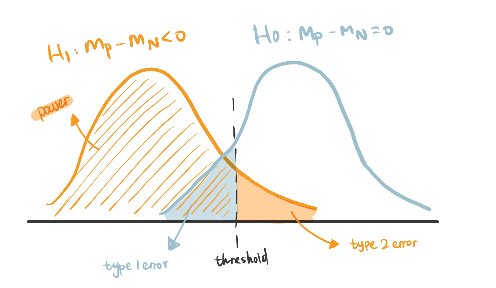

---
title: "Statistical Power"
subtitle: ""
author: "Cole Brookson, MSc"
date: today
format:
  beamer:
    theme: default
    aspectratio: 169
    slide-level: 2
    pdf-engine: xelatex
    include-in-header: ../../assets/beamer-header.tex
    keep-tex: true
# execute:
#      eval: false
--- 


## Free statistical consulting for Yale researchers!

\vspace{2.8em}

\begin{center}

\large
Study design $\cdot$ analysis $\cdot$ visualization $\cdot$ theory.

\vspace{1.4em}

\normalsize
Walk-ins, appointments, and workshops --- free for all Yale affiliates.

\vspace{2.8em}

\textcolor{statsecondary}{%
  \large\textbf{library.yale.edu/statlab}%
}

\end{center}


## Introduction

\vspace{1.4em}

\begin{center}
\large A committee, a reviewer, an IRB, or a funder asks: \textbf{how many subjects do you need?}
\end{center}

{#fig-meme fig-alt="alt" height=50%}

## Schedule

\vspace{0.3em}


## Learning Objectives

\vspace{0.3em}

\small By the end of the session you should be able to:

\vspace{0.4em}

\begin{center}
\begin{enumerate}
  \item Describe the formal definition of statistical power, and relate it to other quantities of interest 
  \item Generalize the formal definition of statistical power to an agnostic view of the "False negative" problem
  \item Calculate power from a closed form in the classic hypothesis testing framing 
  \item Understand and design an agnostic power calculation to quantify effect size recovery in an arbitrary model
\end{enumerate}
\end{center}


## False Negatives and False Positives 


::: {.columns}

::: {.column width="60%"}

- Most diagnostic statistics seek to identify two types of errors:

  - *False Positive* ($\alpha$, Type I) refer to the probability that you will claim an effect is *present* when the **null hypothesis is true**.
  - *False Negatives* ($\beta$, Type II) refer to the probability that you will claim an effect is *absent* when the **null hypothesis is false**.

- Power is what is left over from a false negative error: $\text{power} = 1 - \beta$.

:::

::: {.column width="40%"}

{#fig-cohen fig-alt="alt" height=50%}


:::

:::

\begin{center}
Power is \textbf{the probability of rejecting the null hypothesis when it is in fact false and should be rejected.}
\end{center}

## What is Statistical Power? 

- Less formally: power is a study's ability to *distinguish signal from noise.*

  - The *signal* is the real effect.
  - The *noise* is everything else (e.g., sampling variability, measurement error, differences between units, etc.)


## What Power Looks Like



## Traditional Statistical Power & Its Ingredients

\vskip0pt plus 1filll

When conducting power analysis, our goal is to derive the probability of *detecting* a positive effect when the null hypothesis is false.

- Many studies use $\text{power} \geq 80\%$ (equivalently, $\beta \leq 0.20$) as a threshold:
  - Implies that there is a $20\%$ chance that you will *not* find an effect that is present
  - Similar to $\alpha=0.05$ being taken as natural law, uncritical choice of $\beta$ should be discouraged

\vskip0pt plus 1filll

\begin{center}
\textit{``surely, God loves the .06 nearly as much as the .05"} (Rosnow and Rosenthal, 1989)''
\end{center}

## Traditional Statistical Power & Its Ingredients
\vskip0pt plus 1filll


So what do we need to actually calculate this? Well, the constituent components to calculate $1 - \beta$ are: 

* \textbf{$\alpha$, the significance criterion}
* \textbf{$N$, the sample size} 
* \textbf{$\delta$, the population effect size}
\vskip0pt plus 1filll

\begin{center}
\textit{So,} you must be thinking, \textit{what's the formula?!}

\end{center}

## Traditional Statistical Power & Its Ingredients
\vskip0pt plus 1filll


So what do we need to actually calculate this? Well, the constituent components to calculate $1 - \beta$ are: 

* \textbf{$\alpha$, the significance criterion}
* \textbf{$N$, the sample size} 
* \textbf{$\delta$, the population effect size}
\vskip0pt plus 1filll

\begin{center}
\textit{So,} you must be thinking, \textit{what's the formula?!}

Well, as luck would have it, there isn't one. 
\end{center}

## Traditional Statistical Power & Its Ingredients 

\begin{center}
\Large
There isn't a formula for the calculation of power. There are many!
\end{center}

## Let's look at a case where we can find a closed form

The formula depends entirely on what *specific* test you want to run. Here's an example. Let's make the following assumptions: 

1. We have a completely randomized experiment, with two groups are selected to form a binary treatment, each group containing $N \ 2$ 
2. Assume the outcome variable is normally distributed, and the control group has mean $\mu_c$ and the treatment group has $\mu_t$
3. The two groups have a shared standard deviation, $\sigma$

We now say we want to perform a difference of means test, in the two-tailed sense

## Let's look at a case where we can find a closed form

Say we have the following hypothetical situation where we want to compute power:

- A school is piloting a new **tutoring program**, and wants to know if it improves end-of-term test scores (out of 100)
- Students are randomized into two groups, with one half getting tutoring
- Untutored students average $\mu_c = 72$
- The school will consider the program "worth it", if tutoring gets average scores to $\mu_t = 75$
- Scores vary with $\sigma = 10$

## Let's look at a case where we can find a closed form

The formula depends entirely on what *specific* test you want to run. Here's an example. Let's make the following assumptions: 

1. We have a completely randomized experiment, with two groups are selected to form a binary treatment, each group containing $N / 2$ 
2. Assume the outcome variable is normally distributed, and the control group has mean $\mu_c$ and the treatment group has $\mu_t$
3. The two groups have a shared standard deviation, $\sigma$

We now say we want to perform a difference of means test, in the two-tailed sense

\begin{center}
Luckily, in such a simple form, there's a nice asymptotic approximation for the power of the experiment
\end{center}

## Let's look at a case where we can find a closed form

$$
1 - \beta = \Phi \left( \frac{ | \mu_t - \mu_c | \sqrt{N}}{2\sigma} - \Phi^{-1}\ \left(1-\frac{\alpha}{2}\right) \right)
$$

where $\Phi$ is the cumulative distribution function of the standard normal distribution, which is given by: 

$$
\Phi(x) = \frac{1}{\sqrt{2\pi}} \int_{-\infty}^{x} e^{-u^2/2} \, du
$$

that is, the probability that a standard normal variable falls at or below $x$.

## Let's look at a case where we can find a closed form

For the sake of completeness, we can, of course, do this in R:

```{r}
#| code-fold: false
#| echo: true
two_tailed_power <- function(mu_t, mu_c, std_dev, alpha, n) {
    effect_in_sd <- (abs(mu_t - mu_c) * sqrt(n)) / (2 * std_dev)
    critical_val <- qnorm(1 - (alpha / 2)) # phi ^{-1} is qnorm!
    power <- pnorm(effect_in_sd - critical_val)
    power
}

two_tailed_power(mu_t = 75, mu_c = 72, std_dev = 10, alpha = 0.05, n = 400)
```

## Let's look at a case where we can find a closed form

But the standard use case, of course, is often to find a minimum sample size that satisfies the requisite power. 

- Without knowing our sample size, but knowing all the other points, how could we do this? 
- Do you have a guess for what the number for $N$ is?

## Let's look at a case where we can find a closed form - sample size 

Starting with our formula from before: 

$$
1 - \beta = \Phi \left( \frac{ | \mu_t - \mu_c | \sqrt{N}}{2\sigma} - \Phi^{-1}\ \left(1-\frac{\alpha}{2}\right) \right)
$$

if we skip over some substitutions and simplification, we can get to: 

$$
\boxed{N = \frac{4\sigma^2\,(z_{1-\alpha/2} + z_{1-\beta})^2}{(\mu_t - \mu_c)^2}}
$$

where our only two new values are the z-values for $\alpha$ and $\beta$ respectively, which we know to be $z_{1-\alpha/2} = 1.96$ from memory or calculation, and $z_{1-\beta}$ we can get via `qnorm(0.8)` which ends up being $\approx 0.84$.

## Let's look at a case where we can find a closed form - sample size 

$$
\boxed{N = \frac{4\sigma^2\,(z_{1-\alpha/2} + z_{1-\beta})^2}{(\mu_t - \mu_c)^2}}
$$

Your turn! See if you can adapt our function above using the equation here that calculates a sample size that fulfills power = 0.8.

## Let's look at a case where we can find a closed form - sample size 
So, using
$$
\boxed{N = \frac{4\sigma^2\,(z_{1-\alpha/2} + z_{1-\beta})^2}{(\mu_t - \mu_c)^2}}
$$

we can write a function *very* similar to our above function:
```{r}
#| code-fold: false
#| echo: true
n_required <- function(mu_t, mu_c, std_dev, alpha, power) {
  z_sum <- qnorm(1 - alpha / 2) + qnorm(power)
  4 * std_dev^2 * z_sum^2 / (mu_t - mu_c)^2
}
n_required(mu_t = 75, mu_c = 72, std_dev = 10, alpha = 0.05, power = 0.80)
```

There's lots of ways to do this in mostly equivalent ways!

## But what about literally any other case? 

There are lots of reasons why, even for simple problems, we don't want to rely on such an approximation. For instance, what if you

1. don't assume a two-tailed test? 
2. have clustering and want some sort of random effect? 
3. are taking a Bayesian approach? 
4. are using nonparametric statistics?

## What should we do in those other cases?

* Even when power is not as clearly defined, there are still a whole range of things we still want to know about "power"
* Let's start relaxing our definition of power. We can, for now, consider it as: 

\vskip50pt 


\begin{center}
\textbf{The probability that we we \textcolor{red}{recover} a real effect, should one \textcolor{red}{exist}}
\end{center}

## What should we do in those other cases?

What would it mean then, to approach asking questions about power or sample size in a more general sense where we may want to consider:

\vskip20pt 
::: {.columns}

::: {.column width="60%"}

* Non-parametric approaches
* Bayesian approaches
* Or even just moderately more complicated study designs? 

\vskip20pt 

\begin{center}
\textbf{Well, we go gambling}
\end{center}

:::

::: {.column width="40%"}

{#fig-casino fig-alt="alt" height=50%}


:::

:::

## An aside into the casinos at Monaco

::: {.columns}

::: {.column width="60%"}

* Monte Carlo refers to a broad class of methods wherein you use repeated random sampling to obtain some form of numerical result 
* It will be very useful for us when we cannot rely on a closed form solution (which, as a reminder, is in most cases!)
* Essentially, we can use \textcolor{red}{randomness} to solve \textcolor{red}{deterministic} problems

\vskip20pt 

\textit{For any problem with probabilistic interpretation, it can be solved with Monte Carlo}

:::

::: {.column width="40%"}

{#fig-casino fig-alt="alt" height=50%}

:::

:::


## An aside into the casinos at Monaco

::: {.columns}

::: {.column width="60%"}

Let's imagine we want to know the answer to a gambling-related problem with a closed-form answer:

\begin{center}
What's the probability you win on red at the roulette table three spins in a row?
\end{center}
- There are 18 \textcolor{red}{red} pockets out of 38, so the exact answer is 

$$
P(\text{3 reds in a row}) = (18/38)^3 \approx 0.106
$$
:::

::: {.column width="40%"}

{#fig-casino fig-alt="alt" height=50%}

:::

:::

## An aside to the casinos at Monaco

But we could also just... go to the casino 100,000 times:

```{r}
#| code-fold: false
#| echo: true
set.seed(2026)
spins <- matrix(runif(3 * 100000) < 18 / 38, ncol = 3) # each row is 3 spins
mean(rowSums(spins) == 3) # proportion of rows where all three won
```

\begin{center}
If we can describe \textcolor{red}{how the data are generated}, we can estimate \textit{any} probability by running the process many times!
\end{center}

## An aside into the casinos at Monaco

\vskip0pt plus 1filll

\begin{center}
\Large
And whether its the more traditional, rigid form, or our more flexible modern form, power is \textit{just a probability.}
\end{center}

\vskip0pt plus 1filll

## So, how do we do a Monte Carlo simulation, anyways?

In the parametric context, a Monte Carlo power analysis looks like this:

1. **Generate** random data from some distribution with the properties that you expect your real data to have
2. **Analyze** this randomly generated data set with your statistical analysis, whatever that is
3. **Store** the value(s) of the analysis that you're interested in
4. **Repeat** the above steps many times
5. **Compute** power by looking at the proportion of times the statistic or value you're interested in was "correct"

\vskip20pt

\begin{center}
This can be arbitrarily complex or simple!
\end{center}

## So, how do we do a Monte Carlo simulation, anyways?

We can consider all of this to be done, for the sake of simplicity, by three piecemeal functions that we will want to write

- `generate()`: make a fake data set that looks like your study
- `analyze()`: run the analysis you'd *actually* run
- `success()`: decide whether this run "recovered" the effect

and one function that necessarily performs the actual simulation

```{r}
#| code-fold: false
#| echo: true
simulate_power <- function(n_sims, generate, analyze, success) {
    hits <- replicate(n_sims, success(analyze(generate())))
    mean(hits) # proportion of successful runs = power
}
```

## So, how do we do a Monte Carlo simulation, anyways?

We need to make a statement on how we think the data are being generated. For student $i$:

$$
\text{post}_i = \underbrace{\mu_c}_{\text{baseline}} + \underbrace{\delta \, T_i}_{\text{tutoring effect}} + \underbrace{\varepsilon_i}_{\text{noise}}, \qquad \varepsilon_i \sim N(0, \sigma^2)
$$

\vskip10pt

- $\mu_c = 72$: the average score *without* tutoring
- $T_i$: 1 if student $i$ was tutored, 0 if not, so tutored students get an "effect" of $\delta = 3$
- $\varepsilon_i$: our random noise with $\sigma = 10$

\vskip10pt

## So, how do we do a Monte Carlo simulation, anyways?

Let's start with our function that generates data based on our student tutoring example from before.

```{r}
#| code-fold: false
#| echo: true
gen_basic <- function(n = 350, effect = 3, sd = 10) {
    treat <- rep(0:1, each = n / 2) # half control, half tutored
    post <- 72 + effect * treat + rnorm(n, mean = 0, sd = sd)
    data.frame(treat, post)
}

head(gen_basic())
```


## So, how do we do a Monte Carlo simulation, anyways?

```{r}
#| code-fold: false
#| echo: false
#| fig-height: 3
library(ggplot2)

set.seed(2026)
dat <- gen_basic()

ggplot(
  dat,
  aes(x = post, fill = factor(treat, labels = c("Control", "Tutored")))
) +
  geom_density(alpha = 0.5) +
  geom_vline(xintercept = c(72, 75), linetype = "dashed") + # true means
  labs(x = "End-of-term score", y = "Density", fill = NULL) +
  theme_minimal()
```

## So, how do we do a Monte Carlo simulation, anyways?

```{r}
#| code-fold: false
#| echo: true
analyze_lm <- function(dat) {
  fit <- lm(post ~ treat, data = dat) # same as an equal-variance t-test
  summary(fit)$coefficients["treat", ] # estimate, SE, t, p for treat
}

success_sig <- function(est) {
  est[["Pr(>|t|)"]] < 0.05 # did we reject the null?
}

analyze_lm(gen_basic())
```

## Does the casino agree with our nice equation??

```{r}
#| code-fold: false
#| echo: true
set.seed(2026)
simulate_power(
    n_sims = 2000,
    generate = gen_basic,
    analyze = analyze_lm,
    success = success_sig
)
```

\vskip10pt

- Pretty close for only 2000 simulations! 


## Does the casino agree with our nice equation??

- It's worth noting that the simulation has its own error! With $S$ simulations, the Monte Carlo standard error is

$$
\text{SE} = \sqrt{\frac{p(1-p)}{S}}
$$

\begin{center}
Want a more precise answer? \textbf{Go to the casino more times.}
\end{center}

## What if we make this more complicated, arbitrarily so?

I suspect that schools know a lot about their students *before* the program starts. Say we also have each student's **pre-test score**. Our model for student $i$ becomes:

$$
\text{pre}_i \sim N(70, \sigma^2)
$$

$$
\text{post}_i = \underbrace{\mu_c}_{\text{baseline}} + 
\underbrace{\rho\,(\text{pre}_i - 70)}_{\text{what we knew already}} + 
\underbrace{\delta \, T_i}_{\text{tutoring effect}} + 
\underbrace{\varepsilon_i}_{\text{noise}}, 
\qquad \varepsilon_i \sim N\big(0,\ \sigma^2(1-\rho^2)\big)
$$

\vskip05pt

- $\rho = 0.6$ is the correlation between pre-test and end-of-term scores
- Students who were above average before tend to stay above average
- The total spread of scores is still $\sigma = 10$

## What if we make this more complicated, arbitrarily so?

* We only need to change **two** of our three pieces:

```{r}
#| code-fold: false
#| echo: true
gen_pretest <- function(n = 350, effect = 3, sd = 10, rho = 0.6) {
  treat <- rep(0:1, each = n / 2)
  pre <- rnorm(n, mean = 70, sd = sd)
  post <- 72 +
    rho * (pre - 70) +
    effect * treat +
    rnorm(n, mean = 0, sd = sd * sqrt(1 - rho^2))
  data.frame(treat, pre, post)
}

analyze_ancova <- function(dat) {
  summary(lm(post ~ treat + pre, data = dat))$coefficients["treat", ]
}
```

## What if we make this more complicated, arbitrarily so?

```{r}
#| code-fold: false
#| echo: true
set.seed(2026)
simulate_power(2000, gen_pretest, analyze_lm, success_sig)
simulate_power(2000, gen_pretest, analyze_ancova, success_sig)
```

\vskip10pt

- We can see that our power jumps from about 80\% to about **94\%**
- Power is a property of the \textcolor{red}{design \textit{and} the analysis}, not just of $N$
- If we were really strapped for students to enroll, this could be really helpful to know!

\small
(To be fair: this case still has a closed form ($\sigma$ just becomes $\sigma\sqrt{1-\rho^2}$) but we didn't need to know that!)

## Let's make it even **more** complicated! 

Consider the classic problem of dropout. Let's make the following assumptions about our study (maybe we base this on some sort of past experience running such a study):

- Students who are doing *badly* are more likely to stop showing up
- The **control group loses more students** (here, about 23\% vs. 11\%)

\vskip20pt

\begin{center}
You may ask: \textit{Is there a formula for the power of this study?} \\
\vskip5pt
\textbf{Not really.} Dropout depends on an \textit{unrealized outcome}, so the \textcolor{red}{sample size}, the \textcolor{red}{effect we estimate}, \textit{and} the \textcolor{red}{noise} all change at once!! What a pain!!
\end{center}

## Let's make it even **more** complicated! 

But we don't need a formula! We can use our computers!! We just need to describe how the data are generated:

```{r}
#| code-fold: false
#| echo: true
gen_dropout <- function(n = 350, effect = 3, sd = 10, rho = 0.6) {
    dat <- gen_pretest(n, effect, sd, rho)
    p_drop <- plogis(-2.2 + 0.7 * (dat$treat == 0) - 0.12 * (dat$post - 72))
    dat[runif(n) > p_drop, ] # we only observe the students who stayed
}

nrow(gen_dropout()) # out of the 350 we enrolled
```

## Let's make it even **more** complicated! 

```{r}
#| code-fold: false
#| echo: true
set.seed(2026)
simulate_power(2000, gen_pretest, analyze_ancova, success_sig)
simulate_power(2000, gen_dropout, analyze_ancova, success_sig)
```

\vskip10pt

- Remember, dropout doesn't just shrink our sample!

## Let's make it even **more** complicated! 

Because we simulated the data, we *know* the true effect is 3. So we can check:

```{r}
#| code-fold: false
#| echo: true
set.seed(2026)
estimates <- replicate(2000, analyze_ancova(gen_dropout())[["Estimate"]])
mean(estimates)
```

\vskip10pt

- Since students doing poorly *leave*, this biases our results for the control group up
- We appear to **underestimate** the effect

\begin{center}
Unfortuantely, there's no formula for this!!
\end{center}

## Let's make it even **more** complicated! 

Remember our relaxed definition: \textbf{the probability that we \textcolor{red}{recover} a real effect, should one \textcolor{red}{exist}}.

* "Recover" doesn't have to mean a p-value. 

```{r}
#| code-fold: false
#| echo: true
success_close <- function(est) abs(est[["Estimate"]] - 3) < 1.5

set.seed(2026)
simulate_power(2000, gen_pretest, analyze_ancova, success_close) # no dropout
simulate_power(2000, gen_dropout, analyze_ancova, success_close) # dropout
```

## Let's make it even **more** complicated! 

\large
There are other options for recovery! You could ask when: 

* the CI excludes zero
* the CI is narrower than some width
* the sign is right
* a posterior probability exceeds 0.9 or 0.95
* and much more!

## So, how many students do we need?!

Just like before, we want to find the $N$ that gets us to 80\%. Now, instead of inverting a formula, we try a grid of sample sizes:

```{r}
#| code-fold: false
#| echo: true
set.seed(2026)
ns <- seq(150, 500, by = 50)
powers <- sapply(ns, \(n) {
  simulate_power(
    1000,
    generate = \() gen_dropout(n = n),
    analyze = analyze_ancova,
    success = success_sig
  )
})
```

## So, how many students do we need?

```{r}
#| code-fold: false
#| echo: false
#| fig-height: 3.5
plot(
  ns,
  powers,
  type = "b",
  pch = 19,
  ylim = c(0, 1),
  xlab = "Students enrolled (N)",
  ylab = "Simulated power"
)
abline(h = 0.8, lty = 2, col = "red")
```

\begin{center}
\small With dropout, we need to enrol \textbf{around 450 students}. Alas, more students only buys \textit{power} because the estimate is \textcolor{red}{still biased}.
\end{center}

## Your turn!


\small
\textit{Tip:} mixed models are slow inside \texttt{replicate()} --- start with 200 simulations, and only crank it up once your code works.


## Notes on where i'm going here

* the reason why power analysis came to be so big when it did was that a huge majority of the statistics people had the capacity to do were all still relatively "simple" so to speak
* we are making a really strong set of philosophical assumptions here as well. We say we're only interested in a null hypothesis significance test, we don't care about clustering/grouping/random effects, we are insisting on working in a parametric framework even though if we're interested in power it's quite often because we need to come up with a known sample size and non-parametric statistics are often much more robust in that case. We're also barring ourselves from taking a less prescriptive hypothesis testing approach, and we're completely excluding the possibility of bayesian philosphy or machinery. We're also placing a LOT of emphasis on statistical significance as the primary focus of study, and we know that statistically significant results can be mis-leading in small-sample noisy settings (Gelman & Carlin 2014)
* but there exists a whole range of things we might want to still know about our "power" in all of those circumstances 
* Let's start by relaxing our definition for power. From now on, we'll think about it as the probability that we do not recover a real effect, should one exist 
* what would it mean then, to approach asking questions about power or sample size or any number of other things, in a more general sense where we may want to consider non-parametric approaches, Bayesian approaches, or even just moderately more complicated study designs? Well, we go gambling (Monte Carlo)
* Then, we do the following (in the parametric context):
  * Generate random data from some distribution with the properties that you expect your real data to have 
  * Peform your statistical analysis, whatever that is, on this randomly generated data set 
  * Store the value(s) of the analysis that you're interested in 
  * repeat the above steps many times 
  * Compute the actual power by looking at the proportion of times the statistic or value you're interested in was "correct"