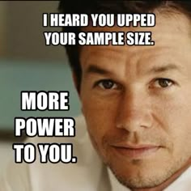
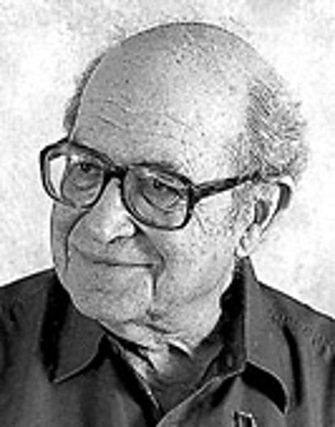
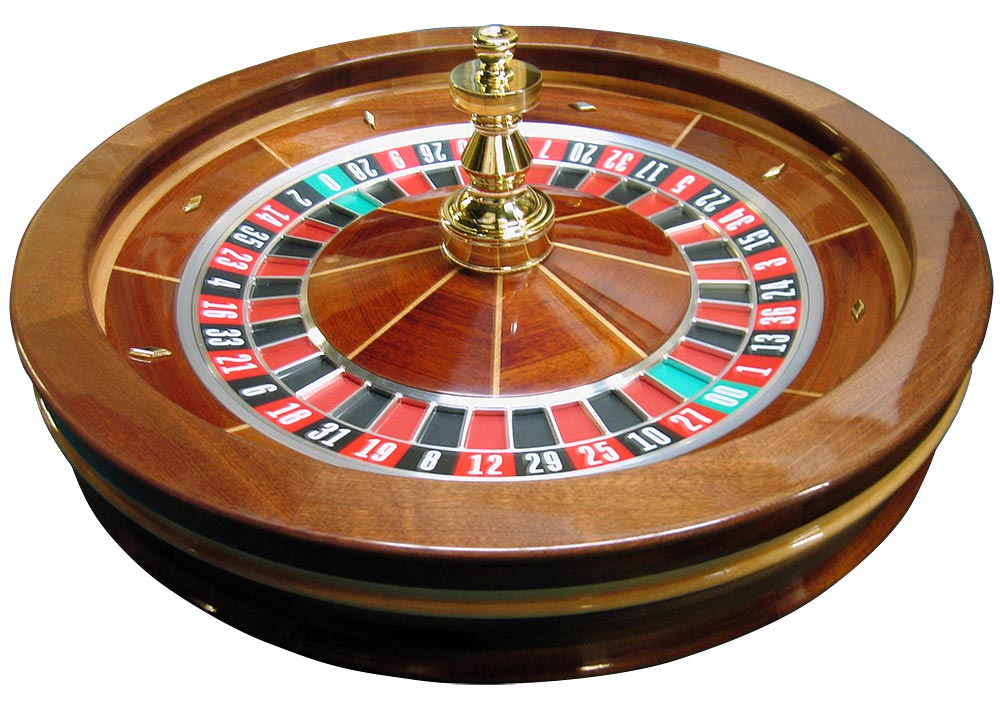

## Free statistical consulting for Yale researchers

\vspace{2.8em}

\begin{center}

\large
Study design $\cdot$ analysis $\cdot$ visualization $\cdot$ writing.

\vspace{1.4em}

\normalsize
Walk-ins, appointments, and workshops --- free for all Yale affiliates.

\vspace{2.8em}

\textcolor{statsecondary}{%
  \large\textbf{library.yale.edu/statlab}%
}

\end{center}


## Introduction

\vspace{1.4em}

\begin{center}
\large A committee, a reviewer, an IRB, or a funder asks: \textbf{how many subjects do you need?}
\end{center}

{#fig-meme fig-alt="alt" height=50%}


## Schedule

\vspace{0.3em}

\begin{center}
\footnotesize
\setlength{\tabcolsep}{7pt}
\renewcommand{\arraystretch}{1.05}
\begin{tabular}{c>{\raggedright\arraybackslash}p{7.8cm}>{\raggedright\arraybackslash}p{3.1cm}}
\toprule
\textbf{Min} & \textbf{Block} & \textbf{Who is working} \\
\midrule
10 & What power is                                              & Lecture \\
9  & The formula, worked by hand; the smallest detectable effect & Lecture \\
16 & \textcolor{statsecondary}{\textbf{Your turn 1:}} a tutoring study, by hand and in the EGAP app & \textbf{You work} \\
6  & Where the assumptions come from                            & \textbf{Pairs} \\
4  & The formula in R, swept over $N$                           & Demo \\
15 & \textcolor{statsecondary}{\textbf{Your turn 2:}} a sleep study, on a budget & \textbf{Groups} \\
\midrule
5  & \textit{Break}                                             & --- \\
\midrule
14 & Simulation: the recipe, checked against the formula        & Demo + predictions \\
5  & Adding a covariate                                         & Demo + predictions \\
14 & \textcolor{statsecondary}{\textbf{Your turn 3:}} simulate a study with dropout & \textbf{Groups} \\
3  & What invalidates a standard calculation                    & Lecture \\
18 & \textcolor{statsecondary}{\textbf{Your turn 4:}} simulate your own design & \textbf{You code} \\
\bottomrule
\end{tabular}
\end{center}


## Learning Objectives

\vspace{0.3em}

\small By the end of the session you should be able to:

\vspace{0.4em}

\begin{center}
\scriptsize
\setlength{\tabcolsep}{7pt}
\renewcommand{\arraystretch}{1.15}
\begin{tabular}{>{\raggedright\arraybackslash}p{7.3cm}>{\raggedright\arraybackslash}p{5.4cm}}
\toprule
\textbf{You will be able to} & \textbf{You will show it by} \\
\midrule
\textbf{Define} power in terms of Type I and Type II error, and \textbf{name} the quantities that determine it
  & Saying which of those quantities a design lets you change \\
\textbf{Compute} power and the minimum detectable effect for a two-arm difference in means
  & Working an example by hand, then checking it in the EGAP calculator \\
\textbf{Sweep} the formula over sample sizes and effect sizes in R, and \textbf{justify} the effects you assume
  & Finding the $N$ a study needs, and whether a budget can pay for it \\
\textbf{Simulate} power for a design the formula does not cover
  & Writing \texttt{generate()}, \texttt{analyze()}, and \texttt{success()} for your own study \\
\textbf{Identify} design features that invalidate a standard calculation
  & Naming the adjustment for clustering, attrition, take-up, and interactions \\
\bottomrule
\end{tabular}
\end{center}


## False Negatives and False Positives (Type I and Type II Errors)

::: {.columns}

::: {.column width="62%"}

\small

- A hypothesis test can make two errors:
  - *False positive* ($\alpha$, Type I): claiming an effect is *present* when the **null hypothesis is true**.
  - *False negative* ($\beta$, Type II): claiming an effect is *absent* when the **null hypothesis is false**.
- Power is the probability of avoiding a false negative: $\text{power} = 1 - \beta$.
- The usual target is power $\geq 0.80$, a 20\% chance of missing a real effect. Like $\alpha = 0.05$, this is a convention; use a different value if you can justify it.

:::

::: {.column width="38%"}

{#fig-cohen fig-alt="alt" height=50%}

:::

:::


## What Power Looks Like

```{r power-picture, echo=FALSE, message=FALSE, warning=FALSE, fig.width=7.6, fig.height=2.75, dev="png", dpi=300, fig.align="center"}
library(ggplot2)
cv <- qnorm(0.975)
zz <- seq(-3.6, 6.2, length.out = 700)
dd <- rbind(
  data.frame(z = zz, y = dnorm(zz, 0), curve = "If the null is true"),
  data.frame(
    z = zz,
    y = dnorm(zz, 2.24),
    curve = "If the 7-point effect is real"
  )
)

ggplot(dd, aes(z, y)) +
  geom_area(
    data = subset(dd, curve != "If the null is true" & z >= cv),
    fill = "#4A90C2",
    alpha = 0.55
  ) +
  geom_area(
    data = subset(dd, curve == "If the null is true" & z >= cv),
    fill = "#B41E1E",
    alpha = 0.70
  ) +
  geom_line(aes(colour = curve), linewidth = 0.75) +
  geom_vline(
    xintercept = cv,
    colour = "grey20",
    linewidth = 0.4,
    linetype = "dashed"
  ) +
  annotate(
    "text",
    x = 3.6,
    y = 0.20,
    label = "power = 0.61",
    colour = "#0B2E52",
    size = 3.1,
    fontface = "bold"
  ) +
  annotate(
    "text",
    x = 2.45,
    y = 0.045,
    label = "alpha/2 == 0.025",
    parse = TRUE,
    colour = "#B41E1E",
    size = 2.7,
    hjust = 0
  ) +
  annotate(
    "text",
    x = cv,
    y = 0.43,
    label = "reject to the right of 1.96",
    colour = "grey20",
    size = 2.7,
    hjust = -0.04
  ) +
  scale_colour_manual(
    values = c(
      "If the null is true" = "#B41E1E",
      "If the 7-point effect is real" = "#0B2E52"
    ),
    name = NULL
  ) +
  # 1.96 and 2.24 nearly collide on the axis; drop the second label a row
  scale_x_continuous(
    breaks = c(0, cv, 2.24),
    labels = c("0", "1.96", "\n2.24")
  ) +
  labs(x = "Effect, measured in standard errors", y = NULL) +
  theme_minimal(base_size = 9) +
  theme(
    panel.grid.minor = element_blank(),
    panel.grid.major.y = element_blank(),
    panel.grid.major.x = element_line(linewidth = 0.25, colour = "grey88"),
    axis.text.y = element_blank(),
    axis.title = element_text(colour = "grey30"),
    legend.position = "bottom",
    legend.margin = margin(t = -6)
  )
```

\vspace{-0.2em}

\begin{center}
\footnotesize \textcolor{errorred}{\textbf{Red}} is the distribution of the test statistic if there is no effect; the shaded area past 1.96 is $\alpha$, the false-positive rate. \textcolor{statsecondary}{\textbf{Blue}} is the distribution if the effect is real; \textbf{the shaded area past the same line is power}.
\end{center}


## Core Notation

Power depends on four quantities:

\vspace{0.5em}

\begin{center}
\small
\setlength{\tabcolsep}{7pt}
\renewcommand{\arraystretch}{1.35}
\begin{tabular}{c>{\raggedright\arraybackslash}p{2.7cm}>{\raggedright\arraybackslash}p{5.6cm}>{\raggedright\arraybackslash}p{3.6cm}}
\toprule
\textbf{Symbol} & \textbf{Quantity} & \textbf{What it is} & \textbf{Can you change it?} \\
\midrule
$N$              & Sample size        & Total number of subjects. & Yes, within your budget. \\
$\mu_t - \mu_c$  & Effect size        & The true difference between treatment and control means. & Partly: dose, duration, framing. \\
$\sigma$         & Standard deviation & How much outcomes vary between subjects. & Partly: better measures, covariates. \\
$\alpha$         & Significance level & The false-positive rate you accept. & Yes; usually 0.05. \\
\bottomrule
\end{tabular}
\end{center}

\vspace{0.4em}

\begin{center}
\small Larger effects, smaller $\sigma$, and larger $N$ all raise power. In code and in the appendix we write the effect as $\delta$.
\end{center}


## The Formula for a Two-Arm Experiment

\vspace{0.2em}

\begin{center}
$\displaystyle \text{power} \;=\; \Phi\!\left( \frac{|\mu_t - \mu_c|\sqrt{N}}{2\sigma} \;-\; \Phi^{-1}\!\left(1-\frac{\alpha}{2}\right) \right)$
\end{center}

\vspace{0.6em}

\small
$\Phi$ is the standard normal CDF: $\Phi(x)$ is the probability that a standard normal variable is at or below $x$. $\Phi^{-1}$ is its inverse: it returns the $z$ value with a given area to its left.

\vspace{0.6em}

The formula holds when:

- subjects are randomly assigned to two arms of $N/2$ each,
- the outcome is normally distributed with the same $\sigma$ in both arms,
- the analysis is a two-sided difference-in-means test.

\vspace{0.4em}

\scriptsize Source: Coppock, \textit{10 Things to Know About Statistical Power} (EGAP). EGAP writes power as $\beta$; we use $\beta$ for the Type II error rate, so power $= 1-\beta$.


## A Running Example: Does the Message Move Opinion?

\begin{notebox}
\small You are fielding a survey experiment with \textbf{164 respondents}, randomly assigned 50/50 to read a short informational message (treatment) or no message (control). Support for the policy is measured on a 0--100 feeling thermometer, and a pilot study supplies your assumptions.
\end{notebox}

\vspace{0.2em}

\begin{center}
\small
\setlength{\tabcolsep}{7pt}
\renewcommand{\arraystretch}{1.2}
\begin{tabular}{cc>{\raggedright\arraybackslash}p{7.4cm}}
\toprule
\textbf{Symbol} & \textbf{Value} & \textbf{Where it comes from} \\
\midrule
$N$      & 164  & Total respondents (82 per arm). \\
$\mu_t$  & 57   & Assumed mean support under treatment. \\
$\mu_c$  & 50   & Control mean, from the pilot. \\
$\sigma$ & 20   & Standard deviation, from the pilot. \\
$\alpha$ & 0.05 & Two-sided, by convention. \\
\bottomrule
\end{tabular}
\end{center}

\vspace{0.2em}

\small Assumed effect: $\mu_t - \mu_c = 7$ points, or $0.35\sigma$. \textbf{What is the power to detect a 7-point effect with 164 respondents?}


## Step 1: Do the Arithmetic

\vspace{0.2em}

\begin{align*}
\text{power} &= \Phi\!\left( \frac{|\mu_t - \mu_c|\sqrt{N}}{2\sigma} \;-\; \Phi^{-1}\!\left(1-\frac{\alpha}{2}\right) \right)
   && \text{\small the formula} \\[0.25em]
&= \Phi\!\left( \frac{7\,\sqrt{164}}{2(20)} \;-\; \textcolor{statsecondary}{1.96} \right)
   && \text{\small plug in; \;\; $\Phi^{-1}(0.975) = 1.96$} \\[0.25em]
&= \Phi\!\left( \textcolor{statsecondary}{\mathbf{2.24}} \;-\; 1.96 \right) \;=\; \textcolor{statsecondary}{\Phi(\mathbf{0.28})}
   && \text{\small $7 \times 12.81 / 40 = 2.24$}
\end{align*}

\vspace{0.5em}

\begin{center}
\small
$\underbrace{\mathbf{2.24}}_{\text{expected } z}$ \qquad
$\underbrace{\mathbf{1.96}}_{\text{critical value}}$ \qquad
$\underbrace{\mathbf{0.28}}_{\text{difference}}$
\end{center}

\vspace{0.5em}

\begin{center}
\scriptsize The smaller the difference between the expected $z$ and the critical value, the lower the power. \\
(The appendix shows how to find $1.96$ in the $z$-table.)
\end{center}


## Step 2: Read the Answer Off the Table

\begin{columns}[T]

\begin{column}{0.30\textwidth}
\vspace{0.6em}

\begin{center}
$\text{power} = \Phi(\mathbf{0.28})$
\end{center}

\vspace{0.5em}

\footnotesize
Split the $z$-score across the two margins of the table:

\vspace{0.4em}

\hspace{0.5em}$\mathbf{0.2}\;$ selects the \textbf{row}

\vspace{0.2em}

\hspace{0.5em}$\mathbf{0.08}$ selects the \textbf{column}

\vspace{0.5em}

The cell where they meet is the area to the \textit{left} of $z$, which is the power.
\end{column}

\begin{column}{0.70\textwidth}
\begin{center}
\scriptsize
\setlength{\tabcolsep}{2.4pt}
\renewcommand{\arraystretch}{1.25}
\begin{tabular}{c|cccccccccc}
\toprule
$z$ & .00 & .01 & .02 & .03 & .04 & .05 & .06 & .07 & \cellcolor{stataccbg}\textbf{.08} & .09 \\
\midrule
0.0 & .5000 & .5040 & .5080 & .5120 & .5160 & .5199 & .5239 & .5279 & \cellcolor{stataccbg}.5319 & .5359 \\
0.1 & .5398 & .5438 & .5478 & .5517 & .5557 & .5596 & .5636 & .5675 & \cellcolor{stataccbg}.5714 & .5753 \\
\cellcolor{stataccbg}\textbf{0.2} & \cellcolor{stataccbg}.5793 & \cellcolor{stataccbg}.5832 & \cellcolor{stataccbg}.5871 & \cellcolor{stataccbg}.5910 & \cellcolor{stataccbg}.5948 & \cellcolor{stataccbg}.5987 & \cellcolor{stataccbg}.6026 & \cellcolor{stataccbg}.6064 & \cellcolor{statorange}\textbf{\color{white}.6103} & \cellcolor{stataccbg}.6141 \\
0.3 & .6179 & .6217 & .6255 & .6293 & .6331 & .6368 & .6406 & .6443 & \cellcolor{stataccbg}.6480 & .6517 \\
0.4 & .6554 & .6591 & .6628 & .6664 & .6700 & .6736 & .6772 & .6808 & \cellcolor{stataccbg}.6844 & .6879 \\
0.5 & .6915 & .6950 & .6985 & .7019 & .7054 & .7088 & .7123 & .7157 & \cellcolor{stataccbg}.7190 & .7224 \\
\bottomrule
\end{tabular}
\end{center}
\end{column}

\end{columns}

\vspace{0.5em}

\begin{center}
\large $\text{power} \;=\; \Phi(0.28) \;=\; \textcolor{statorange}{\mathbf{0.61}}$
\end{center}


## The Smallest Effect This Study Can Detect

\small Fix power at 80\% and solve the same formula for the effect. The result is the \textbf{minimum detectable effect} (MDE).

\vspace{0.3em}

\begin{center}
$\displaystyle \text{MDE} \;=\; \underbrace{\left(\Phi^{-1}\!\left(1-\tfrac{\alpha}{2}\right) + \Phi^{-1}(0.80)\right)}_{1.96 \;+\; 0.84 \;=\; 2.80} \;\times\; \underbrace{\frac{2\sigma}{\sqrt{N}}}_{\text{standard error}}$
\end{center}

\vspace{0.3em}

\begin{center}
\scriptsize
\setlength{\tabcolsep}{9pt}
\renewcommand{\arraystretch}{1.08}
\begin{tabular}{ccc}
\toprule
$N$ & \textbf{Minimum detectable effect} & \textbf{In standard deviations} \\
\midrule
\textcolor{statorange}{\textbf{164}} & \textcolor{statorange}{\textbf{8.75 points}} & \textcolor{statorange}{\textbf{0.44$\sigma$}} \\
257  & 6.99 & 0.35$\sigma$ \\
400  & 5.60 & 0.28$\sigma$ \\
800  & 3.96 & 0.20$\sigma$ \\
1396 & 3.00 & 0.15$\sigma$ \\
\bottomrule
\end{tabular}
\end{center}

\vspace{0.2em}

\begin{center}
\small The pilot assumes 7 points, but with 164 respondents only effects of $\textcolor{statorange}{\mathbf{8.75}}$ points or more have 80\% power. \\[0.3em]
\footnotesize Solved for $N$ instead: \; $N = 4\sigma^2\big(z_{1-\alpha/2} + z_{0.80}\big)^2 / (\mu_t - \mu_c)^2$.
\end{center}


## Your Turn: Is the Tutoring Program Worth Studying?

\vspace{0.5em}

\begin{notebox}
\small A colleague is evaluating a new tutoring program. \textbf{400 students} will be randomly assigned, 200 to tutoring and 200 to business as usual, with final exam score as the outcome. Past cohorts averaged \textbf{72} points with a standard deviation of \textbf{10}, and the program is expected to add \textbf{3} points.
\end{notebox}

\vspace{0.7em}

\begin{center}
\large \textbf{What is the power of this design?}
\end{center}

\vspace{0.7em}

\begin{columns}[c]

\begin{column}{0.46\textwidth}
\begin{center}
\footnotesize
\setlength{\tabcolsep}{10pt}
\renewcommand{\arraystretch}{1.2}
\begin{tabular}{cc}
\toprule
\textbf{Symbol} & \textbf{Value} \\
\midrule
$N$      & 400  \\
$\mu_t$  & 75   \\
$\mu_c$  & 72   \\
$\sigma$ & 10   \\
$\alpha$ & 0.05, two-sided \\
\bottomrule
\end{tabular}
\end{center}
\end{column}

\begin{column}{0.50\textwidth}
\footnotesize
The formula and the $z$-table are on your \textbf{handout}.

\vspace{0.6em}

Work it in three steps:

\vspace{0.3em}

\hspace{0.4em}1. Compute the expected $z$

\vspace{0.2em}

\hspace{0.4em}2. Subtract the critical value

\vspace{0.2em}

\hspace{0.4em}3. Look the difference up in the table

\vspace{0.6em}

\textit{If you finish early:} what is the MDE at $N = 400$?
\end{column}

\end{columns}


## Your Turn: The Solution

\vspace{0.2em}

\begin{align*}
\text{power} &= \Phi\!\left( \frac{|75 - 72|\,\sqrt{400}}{2(10)} \;-\; \Phi^{-1}\!\left(1-\tfrac{0.05}{2}\right) \right)
   && \text{\small \textbf{Step 1:} plug in} \\[0.25em]
&= \Phi\!\left( \frac{3 \times 20}{20} \;-\; 1.96 \right)
   && \text{\small \textbf{Step 2:} $\sqrt{400} = 20$; $\Phi^{-1}(0.975) = 1.96$} \\[0.25em]
&= \Phi(3.00 - 1.96) \;=\; \textcolor{statsecondary}{\Phi(\mathbf{1.04})}
   && \text{\small \textbf{Step 3:} simplify} \\[0.25em]
&= \mathbf{0.85}
   && \text{\small \textbf{Step 4:} row $1.0$, column $.04 \to .8508$}
\end{align*}

\vspace{0.4em}

\begin{center}
\small MDE at $N = 400$: \; $2.80 \times 2(10)/\sqrt{400} = \mathbf{2.80}$ points.
\end{center}


## Check Your Work: The EGAP Power Calculator

\vspace{0.3em}

\begin{center}
\small \url{https://egap.shinyapps.io/power-app/}
\end{center}

\vspace{0.6em}

\begin{center}
\small
\setlength{\tabcolsep}{7pt}
\renewcommand{\arraystretch}{1.25}
\begin{tabular}{c>{\raggedright\arraybackslash}p{6.4cm}c}
\toprule
\textbf{Our symbol} & \textbf{Field in the app} & \textbf{Enter} \\
\midrule
$\mu_t - \mu_c$ & Treatment Effect Size                  & 3    \\
$\sigma$        & Standard Deviation of Outcome Variable & 10   \\
$\alpha$        & Significance Level                     & 0.05 \\
                & Power Target                           & 0.8  \\
                & Maximum Number of Subjects             & 800  \\
\bottomrule
\end{tabular}
\end{center}

\vspace{0.5em}

\begin{center}
\small Leave \textit{Clustered Design} and \textit{Binary Dependent Variable} unchecked. (The appendix shows what clustering does to $N$.)
\end{center}


## Reading the Power Curve

\begin{columns}[c]

\begin{column}{0.53\textwidth}
\includegraphics[width=\linewidth]{images/egap-power-app.png}
\end{column}

\begin{column}{0.45\textwidth}
\footnotesize
\setlength{\itemsep}{0.35em}
\begin{itemize}
\item The $x$-axis is \textbf{total sample size}; the $y$-axis is \textbf{power}.
\item The blue curve shows power as $N$ grows, holding the effect at 3 and $\sigma$ at 10.
\item The red dashed line marks the \textbf{80\% target}. The curve crosses it at the $N$ you need: \textbf{349}.
\item Our $N = 400$ is to the \textit{right} of that point. Reading up from 400 gives $\approx \mathbf{0.85}$.
\item The curve flattens: past about 600 students, each additional student adds little power.
\end{itemize}
\end{column}

\end{columns}


## Where Do the Assumptions Come From?

\small Power calculations are most useful \textit{before} data collection, so every input is an estimate. \textbf{In pairs:} pick a study one of you is planning. For each row, say where your number would come from.

\begin{center}
\footnotesize
\setlength{\tabcolsep}{7pt}
\renewcommand{\arraystretch}{1.0}
\begin{tabular}{>{\raggedright\arraybackslash}p{4.0cm}>{\raggedright\arraybackslash}p{8.7cm}}
\toprule
\textbf{The estimate} & \textbf{Possible sources} \\
\midrule
How big an effect should I expect? \newline \textcolor{statsecondary}{$\mu_t - \mu_c$, \; $\sigma$}
& \leavevmode\uncover<2->{\textbullet~Published effects, discounted for publication bias}\newline
\uncover<2->{\textbullet~A pilot or baseline wave, which gives $\sigma$ directly}\newline
\uncover<2->{\textbullet~The \textit{smallest} effect that would change a decision} \\
\midrule
How many people can I afford to treat? \newline \textcolor{statsecondary}{$N$}
& \leavevmode\uncover<3->{\textbullet~Budget divided by cost per subject}\newline
\uncover<3->{\textbullet~Field period, staff time, partner capacity}\newline
\uncover<3->{\textbullet~Size of the population you can reach} \\
\midrule
How many will respond and stay? \newline \textcolor{statsecondary}{$N$ analyzed}
& \leavevmode\uncover<4->{\textbullet~Response rates from earlier waves or similar surveys}\newline
\uncover<4->{\textbullet~Attrition rates in similar designs}\newline
\uncover<4->{\textbullet~Compute power for the $N$ you will analyze, not the $N$ you invite} \\
\bottomrule
\end{tabular}
\end{center}

\vspace{-0.6em}

\uncover<5->{\begin{center}
\footnotesize Each source gives a range, not a single number. The next step is to compute power across that range.
\end{center}}


## What If We Don't Know the Effect?

\vspace{0.2em}

\small Back to the survey experiment. The pilot fixed everything \textit{except} the expected effect size.

\vspace{0.5em}

\begin{columns}[T]

\begin{column}{0.40\textwidth}
\begin{center}
\footnotesize
\setlength{\tabcolsep}{6pt}
\renewcommand{\arraystretch}{1.25}
\begin{tabular}{cc}
\toprule
\multicolumn{2}{c}{\textbf{Fixed by the pilot}} \\
\midrule
$\mu_c$        & 50   \\
$\sigma$       & 20   \\
$\alpha$       & 0.05 \\
target power & 0.80 \\
\midrule
$\mu_t - \mu_c$ & \textcolor{statorange}{\textbf{?}} \\
$N$             & \textcolor{statorange}{\textbf{?}} \\
\bottomrule
\end{tabular}
\end{center}
\end{column}

\begin{column}{0.58\textwidth}
\begin{center}
\footnotesize
\setlength{\tabcolsep}{6pt}
\renewcommand{\arraystretch}{1.25}
\begin{tabular}{>{\raggedright\arraybackslash}p{5.6cm}c}
\toprule
\textbf{Source of the effect} & $\mu_t - \mu_c$ \\
\midrule
Our own pilot                          & 7 \\
A published study of a similar message & 5 \\
That published effect, discounted for publication bias & 3 \\
\bottomrule
\end{tabular}
\end{center}
\end{column}

\end{columns}

\vspace{0.6em}

\begin{center}
\small Instead of choosing one, compute power for all three across a range of $N$.
\end{center}


## The Formula, in Code

```{=latex}
\vspace{0.6em}

\begin{center}
$\displaystyle \text{power} \;=\; \Phi\!\left( \frac{|\mu_t - \mu_c|\sqrt{N}}{2\sigma} \;-\; \Phi^{-1}\!\left(1-\frac{\alpha}{2}\right) \right)$
\end{center}

\vspace{0.9em}
```

```{r power-fn, echo=TRUE}
power_calc <- function(mu_t, mu_c, sigma, N, alpha = 0.05) {
  z <- abs(mu_t - mu_c) * sqrt(N) / (2 * sigma)
  cv <- qnorm(1 - alpha / 2)
  pnorm(z - cv) + pnorm(-z - cv) # both rejection tails
}
```

```{=latex}
\vspace{0.9em}

\begin{center}
\large $\Phi \;=\;$ \texttt{pnorm} \qquad\qquad $\Phi^{-1} \;=\;$ \texttt{qnorm}
\end{center}
```


## Power Across a Range of $N$

```{r sweep, echo=TRUE, message=FALSE, warning=FALSE}
grid <- expand.grid(N = seq(60, 1600, by = 10), delta = c(3, 5, 7))

grid$power <- power_calc(
  mu_t = 50 + grid$delta,
  mu_c = 50,
  sigma = 20,
  N = grid$N
)

head(grid, 3)
```

```{=latex}
\vspace{0.4em}

\begin{center}
\small Three effect sizes $\times$ 155 values of $N$ = `r nrow(grid)` rows. Next, plot \texttt{power} against \texttt{N}.
\end{center}
```


## How Many Respondents Do We Need?

```{r sweep-plot-setup, echo=FALSE, message=FALSE, warning=FALSE}
library(ggplot2)
grid$delta <- factor(grid$delta, levels = c(3, 5, 7))
nstar <- data.frame(delta = factor(c(3, 5, 7), levels = c(3, 5, 7)))
nstar$N <- ceiling((2 * 20 * (qnorm(0.975) + qnorm(0.80)) / c(3, 5, 7))^2)
nstar$power <- 0.80
ramp <- c("3" = "#4A90C2", "5" = "#1F5F8B", "7" = "#0B2E52")
```

```{r sweep-plot, echo=FALSE, fig.width=7.4, fig.height=3.3, dev="png", dpi=300, fig.align="center"}
ggplot(grid, aes(N, power, colour = delta)) +
  geom_hline(
    yintercept = 0.80,
    linetype = "dashed",
    colour = "#B41E1E",
    linewidth = 0.4
  ) +
  geom_line(linewidth = 0.85) +
  geom_point(data = nstar, size = 1.9, colour = "#B41E1E") +
  geom_text(
    data = nstar,
    aes(label = N),
    vjust = 1.9,
    hjust = -0.15,
    size = 3,
    colour = "#B41E1E",
    show.legend = FALSE
  ) +
  scale_colour_manual(values = ramp, name = "Assumed effect (points):") +
  scale_y_continuous(limits = c(0, 1.05), breaks = seq(0, 1, 0.2)) +
  scale_x_continuous(breaks = seq(0, 1600, 200)) +
  labs(x = "Total respondents (N)", y = "Power") +
  theme_minimal(base_size = 10) +
  theme(
    panel.grid.minor = element_blank(),
    panel.grid.major = element_line(linewidth = 0.25, colour = "grey88"),
    axis.title = element_text(colour = "grey30"),
    legend.position = "bottom",
    legend.margin = margin(t = -4),
    legend.key.width = unit(16, "pt"),
    legend.title = element_text(colour = "grey30")
  )
```


## Your Turn (Groups): A Sleep Workshop on a Budget

\small The campus wellness office wants to test a two-session \textbf{sleep workshop} for undergraduates. Students are randomized to the workshop or a waitlist and wear a sleep tracker for two weeks afterward. The outcome is average nightly sleep, in minutes.

\vspace{0.4em}

::: {.columns}
:::: {.column width="40%"}

```{=latex}
\begin{center}
\footnotesize
\setlength{\tabcolsep}{6pt}
\renewcommand{\arraystretch}{1.2}
\begin{tabular}{cc}
\toprule
\multicolumn{2}{c}{\textbf{From last year's tracker data}} \\
\midrule
$\mu_c$  & 400 minutes \\
$\sigma$ & 60 minutes \\
$\alpha$ & 0.05 \\
\midrule
\multicolumn{2}{c}{\textbf{Budget}} \\
\midrule
Cost per student & \$40 \\
Total            & \$12{,}000 \\
\bottomrule
\end{tabular}
\end{center}
```

::::
:::: {.column width="58%"}

```{=latex}
\footnotesize
\textbf{Three sources disagree about the effect:}

\vspace{0.3em}

\begin{tabular}{>{\raggedright\arraybackslash}p{5.6cm}r}
\toprule
\textbf{Source} & \textbf{Effect} \\
\midrule
A pilot with 20 students & +25 min \\
A meta-analysis of similar brief workshops & +15 min \\
The office director: ``Under 10 minutes isn't worth running the workshop'' & +10 min \\
\bottomrule
\end{tabular}

\vspace{0.4em}

\textit{All numbers are hypothetical.}
```

::::
:::


## Your Turn (Groups): What to Produce

\small Work in groups of 3--4. You have about 12 minutes. Open \texttt{scripts/sleep\_group\_activity.R}.

\vspace{0.3em}

\footnotesize
\begin{enumerate}
\item \textbf{Discuss:} which source would you trust most, and what is wrong with each one?
\item \textbf{Sweep:} choose the effect sizes to plan for, and find the smallest $N$ that reaches 80\% power for each.
\item \textbf{Budget:} how many students does \$12{,}000 pay for? Which of your effects can that $N$ detect?
\item \textbf{Report:} write the sentence your group would put in a proposal: \textit{``With N = \_\_\_, the study has 80\% power to detect effects of \_\_\_ minutes or larger.''}
\end{enumerate}

```{r sleep-starter, eval=FALSE, echo=TRUE}
grid <- expand.grid(N = seq(___, ___, by = 10),
                    delta = c(___, ___, ___))
grid$power <- power_calc(mu_t = mu_c + grid$delta, mu_c = mu_c,
                         sigma = sigma, N = grid$N)
```


## Your Turn (Groups): One Solution

```{r sleep-solution, echo=TRUE}
grid <- expand.grid(N = seq(50, 1500, by = 10), delta = c(10, 15, 25))
grid$power <- power_calc(400 + grid$delta, 400, sigma = 60, N = grid$N)

# smallest N with 80% power, for effects of 10, 15, and 25 minutes
sapply(c(10, 15, 25), \(d) min(grid$N[grid$delta == d & grid$power >= 0.8]))

mde_300 <- (qnorm(0.975) + qnorm(0.80)) * 2 * 60 / sqrt(300) # $12,000 / $40
round(mde_300, 1)
```

\footnotesize The budget pays for 300 students, enough to detect effects of `r round(mde_300, 1)` minutes or more. That covers the pilot's 25 minutes, but a pilot of 20 students gives a noisy estimate. The meta-analysis's 15 minutes needs about 510 students (\$20,400).


## Break

\vspace{3em}

\begin{center}
\Large 5 minutes
\end{center}


## Where the Formula Stops Applying

\small The formula covers one design: two arms, a normal outcome, a difference in means. Other tests have their own formulas, and many designs have none.

\vspace{0.4em}

\begin{center}
\small
\setlength{\tabcolsep}{7pt}
\renewcommand{\arraystretch}{1.2}
\begin{tabular}{>{\raggedright\arraybackslash}p{5.3cm}>{\raggedright\arraybackslash}p{7.4cm}}
\toprule
\textbf{The formula assumes} & \textbf{So it does not cover} \\
\midrule
Two arms, split 50/50            & Three arms, unequal allocation \\
One continuous, normal outcome   & Binary outcomes, counts, skewed scales \\
A simple difference in means     & Covariates, fixed effects, IV, mixed models \\
Independent observations         & Clustered or repeated measures \\
Everyone recruited is analyzed   & Attrition, non-response \\
A significance test              & Bayesian or estimation-based goals \\
\bottomrule
\end{tabular}
\end{center}


## A More General Definition of Power

\vspace{1em}

\begin{center}
\large Power is the probability that the analysis \textcolor{statsecondary}{\textbf{recovers}} a real effect, if one exists.
\end{center}

\vspace{1.5em}

\small

- So far, "recovers" has meant $p < 0.05$.
- In a simulation, it can mean any criterion you can check in code: the estimate is within a set distance of the truth, the confidence interval excludes zero, a posterior probability exceeds 0.95.
- With this definition, power can be estimated for any design whose data you can simulate.


## Monte Carlo Simulation

::: {.columns}

::: {.column width="62%"}

\small

- Monte Carlo methods estimate a quantity by repeated random sampling.
- They are useful when there is no closed-form answer, which is the case for most study designs.
- The quantity being estimated is fixed; the random sampling is only the method for computing it.
- Any quantity that can be written as a probability can be estimated this way.

:::

::: {.column width="38%"}

{#fig-ulam fig-alt="Photo of Stanisław Ulam" height=50%}

:::

:::


## Monte Carlo Simulation: A Roulette Example

::: {.columns}

::: {.column width="58%"}

\small

Start with a gambling problem that has an exact answer:

\vspace{0.5em}

\begin{center}
What is the probability of winning on red three spins in a row?
\end{center}

\vspace{0.5em}

- A roulette wheel has 38 pockets, 18 of them red.
- Each spin is independent, so

$$
P(\text{3 reds in a row}) = (18/38)^3 \approx 0.106
$$

- Next: estimate the same number by simulating spins, and compare.

:::

::: {.column width="42%"}

{#fig-roulette fig-alt="A roulette table" height=50%}

:::

:::


## Monte Carlo Simulation: Simulating the Spins

Simulate 100,000 sets of three spins and count how often all three are red:

```{r roulette, echo=TRUE}
set.seed(2026)
spins <- matrix(runif(3 * 100000) < 18 / 38, ncol = 3) # each row is 3 spins
mean(rowSums(spins) == 3) # proportion of rows where all three are red
```

\vspace{0.6em}

\begin{center}
\small If you can write down how the data are generated, you can estimate a probability by running that process many times and counting. Power is a probability, so it can be estimated the same way.
\end{center}


## The Simulation Recipe

\small Write three functions:

- `generate()`: make one fake data set from the model you expect your data to follow
- `analyze()`: run the analysis you will run on the real data
- `success()`: return `TRUE` if this run recovered the effect

Then run them many times. The proportion of successes is the estimated power:

```{r sim-fn, echo=TRUE}
simulate_power <- function(n_sims, generate, analyze, success) {
  hits <- replicate(n_sims, success(analyze(generate())))
  mean(hits) # proportion of successful runs = power
}
```


## Generating Data for the Tutoring Study

For student $i$:

$$
\text{post}_i = \underbrace{\mu_c}_{\text{control mean}} + \underbrace{\delta \, T_i}_{\text{tutoring effect}} + \underbrace{\varepsilon_i}_{\text{noise}}, \qquad \varepsilon_i \sim N(0, \sigma^2)
$$

\footnotesize $\mu_c = 72$; \; $T_i = 1$ if student $i$ was tutored, 0 if not; \; $\delta = 3$; \; $\sigma = 10$. We use $N = 350$, close to the 349 the EGAP curve gave for 80\% power.

```{r gen-basic, echo=TRUE}
gen_basic <- function(n = 350, effect = 3, sd = 10) {
  treat <- rep(0:1, each = n / 2) # half control, half tutored
  post <- 72 + effect * treat + rnorm(n, mean = 0, sd = sd)
  data.frame(treat, post)
}
```


## Analyzing It and Defining Success

```{r analyze-basic, echo=TRUE}
analyze_lm <- function(dat) {
  fit <- lm(post ~ treat, data = dat) # same as an equal-variance t-test
  summary(fit)$coefficients["treat", ] # estimate, SE, t, p for treat
}

success_sig <- function(est) {
  est[["Pr(>|t|)"]] < 0.05 # did we reject the null?
}

analyze_lm(gen_basic())
```

\vspace{0.3em}

\begin{center}
\small \textbf{Predict:} the formula gives power = `r round(power_calc(75, 72, 10, 350), 2)` at $N = 350$. What will 2,000 simulated studies give?
\end{center}


## Does the Simulation Agree with the Formula?

```{r check-basic, echo=TRUE}
set.seed(2026)
simulate_power(n_sims = 2000, generate = gen_basic,
               analyze = analyze_lm, success = success_sig)
```

\vspace{0.4em}

\small The formula gives `r round(power_calc(75, 72, 10, 350), 2)`. The simulated estimate has its own error. With $S$ simulations, the Monte Carlo standard error is

$$
\text{SE} = \sqrt{\frac{p(1-p)}{S}}
$$

which is about 0.009 for $p = 0.80$ and $S = 2{,}000$. For a more precise estimate, increase $S$.


## Adding a Pre-Test

\small Schools often have each student's \textbf{pre-test score}. The model for student $i$ becomes:

$$
\text{pre}_i \sim N(70, \sigma^2)
$$

$$
\text{post}_i = \mu_c +
\underbrace{\rho\,(\text{pre}_i - 70)}_{\text{prior achievement}} +
\delta \, T_i +
\varepsilon_i,
\qquad \varepsilon_i \sim N\big(0,\ \sigma^2(1-\rho^2)\big)
$$

- $\rho = 0.6$ is the correlation between pre-test and end-of-term scores.
- The total standard deviation of post-test scores is still $\sigma = 10$.

\vspace{0.4em}

\begin{center}
\textbf{Predict:} at the same $N = 350$, does adjusting for the pre-test raise or lower power? By how much?
\end{center}


## Adjusting for the Pre-Test: Code

\small Only `generate()` and `analyze()` change:

```{r gen-pretest, echo=TRUE}
gen_pretest <- function(n = 350, effect = 3, sd = 10, rho = 0.6) {
  treat <- rep(0:1, each = n / 2)
  pre <- rnorm(n, mean = 70, sd = sd)
  post <- 72 +
    rho * (pre - 70) +
    effect * treat +
    rnorm(n, mean = 0, sd = sd * sqrt(1 - rho^2))
  data.frame(treat, pre, post)
}

analyze_ancova <- function(dat) {
  summary(lm(post ~ treat + pre, data = dat))$coefficients["treat", ]
}
```


## Adjusting for the Pre-Test: Result

```{r run-pretest, echo=TRUE}
set.seed(2026)
simulate_power(2000, gen_pretest, analyze_lm, success_sig)     # no pre-test
simulate_power(2000, gen_pretest, analyze_ancova, success_sig) # pre-test
```

\vspace{0.4em}

\small

- Same students, same $N$: power rises from about 0.80 to about 0.94.
- Power depends on the \textbf{analysis} as well as on $N$. Adjusting for a pre-treatment covariate costs no additional students.
- This case still has a closed form ($\sigma$ becomes $\sigma\sqrt{1-\rho^2} = 8$), but the simulation did not require knowing it.


## Your Turn (Groups): The Tutoring Study with Dropout

\small Past studies show that students who are doing \textit{badly} stop attending, and the \textbf{control group loses more} students (about 23\% vs.\ 11\%). Dropout depends on the outcome, so it changes the sample size, the estimate, and the noise together. There is no standard formula for this design. Open \texttt{scripts/dropout\_group\_activity.R}; it contains this function and the ones from the demo.

```{r gen-dropout, echo=TRUE}
gen_dropout <- function(n = 350, effect = 3, sd = 10, rho = 0.6) {
  dat <- gen_pretest(n, effect, sd, rho)
  p_drop <- plogis(-2.2 + 0.7 * (dat$treat == 0) - 0.12 * (dat$post - 72))
  dat[runif(n) > p_drop, ] # we only observe the students who stayed
}
nrow(gen_dropout()) # out of the 350 we enrolled
```

## Your Turn (Groups): Tasks

\small Work in groups of 3--4. You have about 10 minutes.

\vspace{0.4em}

\begin{enumerate}
\item \textbf{Predict} before running anything: will dropout raise or lower power? Will the average estimate be above or below the true effect of 3? Why?
\item \textbf{Estimate power} with and without dropout, using \texttt{simulate\_power()}.
\item \textbf{Check for bias:} average the estimated effect over 1,000 simulated studies with dropout.
\item \textbf{Redefine success:} write a \texttt{success()} that counts a run as a success if the estimate is within 1.5 points of 3. Compare power with and without dropout.
\item \textit{If time:} \textbf{sweep over $N$} from 150 to 500. Where does power reach 80\%? Does enrolling more students remove the bias?
\end{enumerate}

\vspace{0.4em}

\footnotesize Use 500--2,000 simulations per estimate. Each task in the script has blanks (\texttt{\_\_\_}) to fill in.


## Your Turn (Groups): Solution, Power and Bias

```{r run-dropout, echo=TRUE}
set.seed(2026)
simulate_power(2000, gen_dropout, analyze_ancova, success_sig)
estimates <- replicate(2000, analyze_ancova(gen_dropout())[["Estimate"]])
mean(estimates) # the true effect is 3
```

\small

- Low-scoring control students leave, which raises the observed control mean, so the estimate is biased \textbf{downward}.
- Power falls because of the smaller sample \textit{and} the smaller estimated effect.
- Enrolling more students raises power, but does not remove the bias (see the sweep two slides ahead).


## Your Turn (Groups): Solution, Other Definitions of Success

\small We know the true effect is 3, so success can be defined by the estimate instead of the $p$-value:

```{r success-close, echo=TRUE}
success_close <- function(est) abs(est[["Estimate"]] - 3) < 1.5

set.seed(2026)
simulate_power(2000, gen_pretest, analyze_ancova, success_close) # no dropout
simulate_power(2000, gen_dropout, analyze_ancova, success_close) # dropout
```

\scriptsize Other options: the CI excludes zero; the CI is narrower than a set width; the estimate has the correct sign; a posterior probability exceeds 0.95. At low power, significant estimates often have the wrong sign or overstate the effect several-fold (Type S and M errors; Gelman and Carlin, 2014).


## Your Turn (Groups): Solution, How Many Students?

```{r dropout-grid, echo=TRUE}
set.seed(2026)
ns <- seq(150, 500, by = 50)
powers <- sapply(ns, \(n) {
  simulate_power(1000, generate = \() gen_dropout(n = n),
                 analyze = analyze_ancova, success = success_sig)
})
```

```{r dropout-plot, echo=FALSE, fig.width=7.4, fig.height=1.55, dev="png", dpi=300, fig.align="center"}
ggplot(data.frame(N = ns, power = powers), aes(N, power)) +
  geom_hline(yintercept = 0.80, linetype = "dashed", colour = "#B41E1E", linewidth = 0.4) +
  geom_line(colour = "#0B2E52", linewidth = 0.8) +
  geom_point(colour = "#0B2E52", size = 1.7) +
  scale_y_continuous(limits = c(0, 1), breaks = seq(0, 1, 0.2)) +
  labs(x = "Students enrolled (N)", y = "Simulated power") +
  theme_minimal(base_size = 9) +
  theme(panel.grid.minor = element_blank())
```

\footnotesize Power reaches 80\% at about 450 students, but the estimate is biased at every $N$. More students raise the rejection rate; they do not make the estimate more accurate.


## What Invalidates a Standard Calculation

\small The formula assumes you randomize individuals, measure a continuous outcome, and analyze everyone you recruit. If any of these fails, the required $N$ changes, usually by a lot.

\vspace{0.3em}

\begin{center}
\scriptsize
\setlength{\tabcolsep}{6pt}
\renewcommand{\arraystretch}{1.2}
\begin{tabular}{>{\raggedright\arraybackslash}p{3.8cm}>{\raggedright\arraybackslash}p{3.4cm}>{\raggedright\arraybackslash}p{5.3cm}}
\toprule
\textbf{If your design has\ldots} & \textbf{Adjust $N$ by} & \textbf{Survey example ($N = 257$ for 7 points)} \\
\midrule
Groups randomized, not individuals & $\times\;\text{DEFF} = 1 + (m-1)\rho$
  & Groups of 25, $\rho = 0.15$: 257 $\rightarrow$ \textbf{1{,}183}. Analyzed as individuals, the false-positive rate is over \textcolor{errorred}{\textbf{35\%}}. \\
Take-up below 100\%    & $\div$ take-up$^2$      & 50\% take-up: 257 $\rightarrow$ \textbf{1{,}028} \\
Attrition              & $\div\;(1 - \text{loss})$ & 20\% loss: recruit \textbf{322} to analyze 257 \\
A binary outcome       & use $\sigma = \sqrt{p(1-p)}$  & 30\% $\rightarrow$ 42\% support with $N = 164$: power \textbf{0.36}, vs.\ 0.61 for the continuous outcome \\
A subgroup difference or interaction & $\approx\;\times 4$     & A 6-point interaction: 257 $\rightarrow$ \textbf{about 1{,}400} \\
\bottomrule
\end{tabular}
\end{center}

\vspace{0.2em}

\footnotesize Attrition that depends on the outcome, as in the dropout example, also biases the estimate. Simulate it.


## Your Turn: Simulate Your Own Design

\small Open \texttt{scripts/power\_sim\_template.R} and fill in each \texttt{\_\_\_}, running each step before moving on.

\vspace{0.4em}

\textbf{Choose your study:}

- \textbf{Your own study.} Use your estimates for the control mean, effect, and standard deviation. If you have pilot or baseline data, use its mean and standard deviation.
- \textbf{No study in mind?} Use the blood-pressure coaching study on the next slide.

\vspace{0.4em}

Complete steps 1--6 in class (about 15 minutes). Step 7 is optional if you finish early.

\vspace{0.4em}

\scriptsize Mixed models are slow inside \texttt{replicate()}. Start with 200 simulations, and increase the number once your code works.


## Your Turn: A Study to Simulate

\begin{notebox}
\small A primary-care clinic wants to test a \textbf{home blood-pressure coaching program}. Patients with hypertension are randomized to six months of phone coaching or usual care. The outcome is systolic blood pressure (mmHg) at six months.
\end{notebox}

\vspace{0.3em}

::: {.columns}
:::: {.column width="44%"}

```{=latex}
\begin{center}
\footnotesize
\setlength{\tabcolsep}{6pt}
\renewcommand{\arraystretch}{1.2}
\begin{tabular}{>{\raggedright\arraybackslash}p{3.0cm}c}
\toprule
\multicolumn{2}{c}{\textbf{From the clinic's records}} \\
\midrule
Mean under usual care & 140 \\
Standard deviation    & 15 \\
Expected effect       & $-5$ \\
Patients the clinic can enroll & 250 \\
\bottomrule
\end{tabular}
\end{center}

\vspace{0.2em}

\centering\scriptsize\textit{All numbers are hypothetical.}
```

::::
:::: {.column width="54%"}

```{=latex}
\footnotesize
\textbf{Steps 1--6:} Does the clinic have 80\% power with 250 patients? If not, how many does it need?

\vspace{0.6em}

\textbf{Step 7, pick one complication:}

\vspace{0.3em}

\textbullet~\textbf{Baseline blood pressure} is recorded at enrollment and correlates 0.5 with the six-month reading. Does adjusting for it get the clinic to 80\%?

\vspace{0.3em}

\textbullet~\textbf{Unequal groups:} the clinic has coaches for only one in three patients. How much power does a 1:2 split cost at $N = 250$?
```

::::
:::


## Your Turn: Questions to Answer at Each Step

\small

1. **Inputs:** what are your control mean, effect, and standard deviation, and where did each number come from?
2. `generate()`: does the fake data set look like data your study could produce?
3. `analyze()`: is this the analysis you will run on the real data?
4. `success()`: what counts as recovering the effect?
5. **Estimate power.** Set the effect to zero: does a significance-based `success()` succeed about 5\% of the time?
6. **Sweep over $N$.** Where does your curve cross 80\%?
7. *(Optional)* **Add a complication:** unequal groups, a covariate, a skewed outcome, or dropout. How much power do you gain or lose?


## Appendix: Where 1.96 Comes From

\begin{columns}[T]

\begin{column}{0.30\textwidth}
\vspace{0.6em}

\begin{center}
$\Phi^{-1}(\mathbf{0.975})$
\end{center}

\vspace{0.5em}

\footnotesize
$\Phi^{-1}$ uses the table in reverse. Given an area, find the $z$ that produces it:

\vspace{0.4em}

\hspace{0.5em}1. Find $.9750$ in the \textbf{body}

\vspace{0.2em}

\hspace{0.5em}2. Read off its \textbf{row and column}

\vspace{0.5em}

Row $1.9$ plus column $.06$ gives $\mathbf{1.96}$.
\end{column}

\begin{column}{0.70\textwidth}
\begin{center}
\scriptsize
\setlength{\tabcolsep}{2.4pt}
\renewcommand{\arraystretch}{1.25}
\begin{tabular}{c|cccccccccc}
\toprule
$z$ & .00 & .01 & .02 & .03 & .04 & .05 & \cellcolor{stataccbg}\textbf{.06} & .07 & .08 & .09 \\
\midrule
1.6 & .9452 & .9463 & .9474 & .9484 & .9495 & .9505 & \cellcolor{stataccbg}.9515 & .9525 & .9535 & .9545 \\
1.7 & .9554 & .9564 & .9573 & .9582 & .9591 & .9599 & \cellcolor{stataccbg}.9608 & .9616 & .9625 & .9633 \\
1.8 & .9641 & .9649 & .9656 & .9664 & .9671 & .9678 & \cellcolor{stataccbg}.9686 & .9693 & .9699 & .9706 \\
\cellcolor{stataccbg}\textbf{1.9} & \cellcolor{stataccbg}.9713 & \cellcolor{stataccbg}.9719 & \cellcolor{stataccbg}.9726 & \cellcolor{stataccbg}.9732 & \cellcolor{stataccbg}.9738 & \cellcolor{stataccbg}.9744 & \cellcolor{statorange}\textbf{\color{white}.9750} & \cellcolor{stataccbg}.9756 & \cellcolor{stataccbg}.9761 & \cellcolor{stataccbg}.9767 \\
2.0 & .9772 & .9778 & .9783 & .9788 & .9793 & .9798 & \cellcolor{stataccbg}.9803 & .9808 & .9812 & .9817 \\
2.1 & .9821 & .9826 & .9830 & .9834 & .9838 & .9842 & \cellcolor{stataccbg}.9846 & .9850 & .9854 & .9857 \\
\bottomrule
\end{tabular}
\end{center}

\vspace{0.6em}

\small This is Step 2 in reverse: start in the body of the table and read outward.
\end{column}

\end{columns}

\vspace{0.4em}

\begin{center}
$\Phi^{-1}(0.975) = \mathbf{1.96}$: the critical value for a two-sided test at $\alpha = 0.05$.
\end{center}


## Appendix: How Many Simulations Is Enough?

\small A simulated power estimate has standard error $\sqrt{\text{power}(1-\text{power})/S}$.

\vspace{0.5em}

\begin{center}
\small
\setlength{\tabcolsep}{9pt}
\renewcommand{\arraystretch}{1.25}
\begin{tabular}{cc>{\raggedright\arraybackslash}p{6.4cm}}
\toprule
\textbf{$S$} & \textbf{$\pm$ at power $= 0.80$} & \textbf{Suitable for} \\
\midrule
200    & 0.028 & Checking that the code runs \\
1{,}000  & 0.013 & Comparing designs \\
2{,}000  & 0.009 & Teaching and prototyping \\
10{,}000 & 0.004 & A number reported in a grant or pre-registration \\
\bottomrule
\end{tabular}
\end{center}

\vspace{0.5em}

\begin{center}
\small A quick check: rerun with a different seed. If the estimate changes more than you can accept, increase $S$.
\end{center}


## Appendix: Estimand and Estimator

\vspace{0.4em}

\begin{center}
\small
\setlength{\tabcolsep}{7pt}
\renewcommand{\arraystretch}{1.25}
\begin{tabular}{>{\raggedright\arraybackslash}p{2.2cm}>{\raggedright\arraybackslash}p{5.0cm}>{\raggedright\arraybackslash}p{5.6cm}}
\toprule
& \textbf{What it is} & \textbf{Examples} \\
\midrule
\textbf{Estimand}  & The quantity you want to learn. A property of the \textit{population}. & The ATE; the effect among women; an interaction; a LATE \\
\textbf{Estimator} & The procedure you run on data. A property of your \textit{code}. & Difference in means; OLS with covariates; 2SLS; a mixed model \\
\bottomrule
\end{tabular}
\end{center}

\vspace{0.6em}

\small Power depends on the estimand, the estimator, and the design together. In the pre-test example, changing the estimator (adding a covariate) raised power. On the next slide, changing the estimand (an interaction instead of the average effect) lowers it.


## Appendix: Power for an Interaction

\footnotesize The message moves group $g=1$ by 10 points and group $g=0$ by 4: the average effect is 7 and the \textbf{interaction} is 6. The interaction's standard error is twice the ATE's, so 80\% power needs about \textbf{1,400} respondents, against 257 for the ATE.

```{r mc-interaction, echo=TRUE}
set.seed(11)
p <- replicate(2000, {
  z <- sample(rep(0:1, each = 82))
  g <- rep(0:1, 82)
  y <- rnorm(164, 50 + 4 * z + 6 * z * g + 2 * g, 20)
  c(ate = coef(summary(lm(y ~ z)))["z", 4],
    int = coef(summary(lm(y ~ z * g)))["z:g", 4])
})
rowMeans(p < 0.05) # N = 164
```


## Appendix: What If x Is a Confounder?

\scriptsize Here `z` is **not randomized**: higher `x` makes treatment more likely. The unadjusted model rejects almost every time, but its estimate is far from 7. A rejection rate measures power only when the estimator is unbiased.

```{r mc-confound, echo=TRUE}
set.seed(3)
sim_obs <- function(adjust, N = 164) {
  out <- replicate(2000, {
    x <- rnorm(N)
    z <- rbinom(N, 1, plogis(1.2 * x)) # z DEPENDS on x
    y <- 50 + 7 * z + 12 * x + rnorm(N, 0, 16) # truth is still 7
    fit <- if (adjust) lm(y ~ z + x) else lm(y ~ z)
    c(coef(fit)["z"], coef(summary(fit))["z", 4])
  })
  c(estimate = mean(out[1, ]), rejection = mean(out[2, ] < 0.05))
}
rbind(`y ~ z` = sim_obs(FALSE), `y ~ z + x` = sim_obs(TRUE))
```


## Appendix: When You Randomize Groups, Not People

\small If you assign whole classrooms, clinics, or villages, observations within a group are correlated. The required $N$ grows by the \textbf{design effect}:

\vspace{0.3em}

\begin{center}
$\text{DEFF} \;=\; 1 + (m - 1)\,\rho$ \qquad \footnotesize $m$ = cluster size, \; $\rho$ = intra-cluster correlation
\end{center}

\vspace{0.5em}

\begin{center}
\small
\setlength{\tabcolsep}{7pt}
\renewcommand{\arraystretch}{1.25}
\begin{tabular}{>{\raggedright\arraybackslash}p{7.2cm}c}
\toprule
\textbf{Survey experiment,} 7-point effect & \textbf{Respondents needed} \\
\midrule
Randomize individuals                                    & 257 \\
Randomize groups of 25, $\rho = 0.15$ (DEFF 4.6)         & \textbf{1,183} \\
\bottomrule
\end{tabular}
\end{center}

\vspace{0.5em}

\begin{center}
\small This is what the \textit{Clustered Design} option in the EGAP app accounts for.
\end{center}


## Appendix: Clustering in Simulation

\footnotesize 300 respondents in 12 groups of 25, $\rho = 0.15$. Analyzed as individuals, the test rejects a true null far more than 5\% of the time. Analyzed as 12 group means, it holds 5\%, but has little power.

```{r mc-cluster, echo=TRUE}
set.seed(7)
sim_clus <- function(tau, k = 12, m = 25) rowMeans(replicate(1500, {
  zc <- sample(rep(0:1, each = k / 2)) # assign GROUPS, not people
  u <- rnorm(k, 0, 20 * sqrt(0.15)) # group-level shock
  y <- rnorm(k * m, rep(50 + tau * zc + u, each = m), 20 * sqrt(0.85))
  c(as_individuals = t.test(y ~ rep(zc, each = m))$p.value,
    as_groups = t.test(tapply(y, rep(1:k, each = m), mean) ~ zc)$p.value)
}) < 0.05)
rbind(`no effect` = sim_clus(0), `7-point effect` = sim_clus(7))
```
